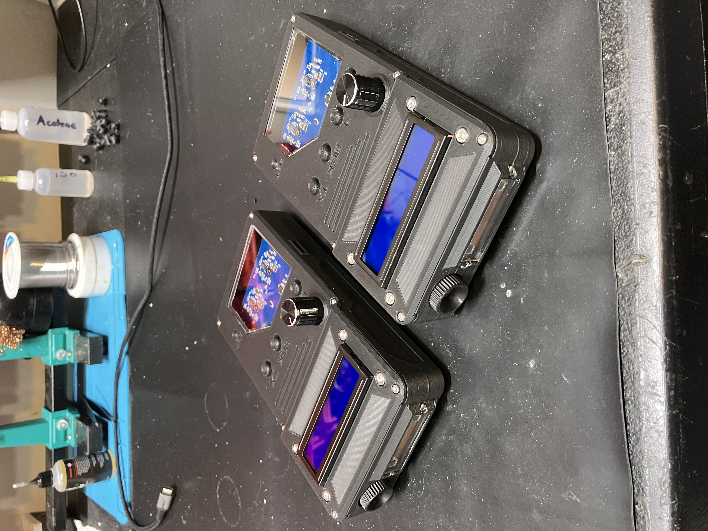
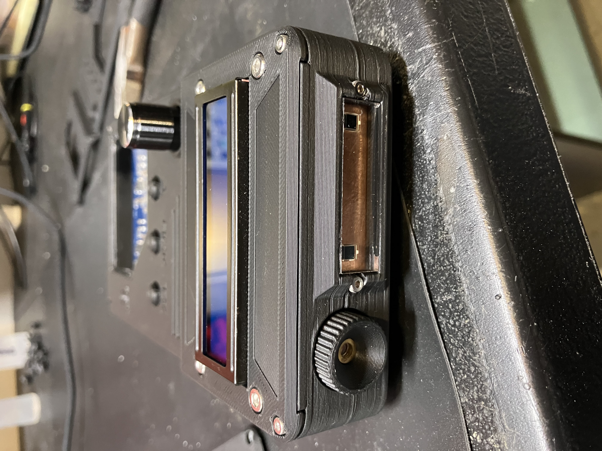

# Handheld Free Space Laser Communicator

*V1.1 completed August 28th, 2026*

A handheld, battery powered free-space optical communications transceiver capable of transmitting binary data over an unguided laser beam through on-off keying.

A user types binary data with two buttons, the transceiver converts this to plaintext using ASCII. This text can be sent between transceivers.

  
  
  

## Specifications

* **Microcontroller:** CH32V203F8P6
* **Directionality:** Half duplex
* **Modulation:** On-off keying
* **Optical source:** Generic cheap 5mW red laser diode
* **Optical receiver:** 2x BPW34 photodiodes, MCP6007 used for transimpedance amplifiers and differential amplifier
* **Power supply:** 2S 7.4V 1000mAh LiPo bucked to +5V and +3V3 with 2x TPP00032
* **PCB:** 2-Layer custom PCB manufactured by JLCPCB

## Architecture

* **Transmitter:** Data payload is output on PA4 of the CH32 at up to ~133kb/s, a level-shifter changes the logic high output from 3V3 to 5V. This drives an IRF540 on the low side of the laser diode. The laser diode has a current limiting resistor built in, so to reduce complexity (especially with the high speed switching of the laser diode), no constant current source is used.

  

* **Receiver:** Two BPW34 photodiodes are located on the front of the device. The photodiode closer to the center of the device only receives ambient light. The photodiode closer to the edge of the device receives the modulated signal in addition to ambient light. Both of the photodiodes' signals are amplified with separate transimpedance amplifiers, then the ambient signal is subtracted from the data. The effect of this is that only the binary signal remains, making it much easier to resolve data. This is then fed into PA7 of the CH32 where the data is read.

  

## Challenges

* **Ambient light rejection:** The most obvious challenge beginning this project was how to resolve a modulated light input when its riding on some unknown, possibly changing ambient signal. As described above, this was handled through the use of a differential amplifier to subtract the ambient signal off the data.
* **Amplifier resolving power:** The gain on the transimpedance amplifiers determines not only how far the signal can be received from (due to the divergent nature of a laser diode) but also the speed at which data can be received. Too sensitive of an amplifier will saturate and lower the maximum receiver bandwidth. Too low sensitivity will lower the maximum reception distance. Because of these factors, the amplifier had to be finely tuned to maximize both bandwidth and sensitivity.
* **High speed data transmission and reception (hardware):** Because the device should be capable of high speed communication, any factor slowing down the rise and fall time of the transmitter had to be minimized. This meant lowering parasitic capacitances and constructing a circuit capable of quickly switching a logic level MOSFET using only a CH32 GPIO pin. In my case, the main bottleneck for these rise / fall times was caused by the MCP6007. With a 1MHz GBW and 1.9V/us slew rate, its minimum rise / fall time from 0V to +3V3 is approximately 1.5 microseconds. This meant that at a certain speed, the receiver would not be able to accurately resolve between logic high and low. Experimentation was done adjusting the speed of the transmitter until a bitrate was achieved that allowed for high speed and high accuracy reception. In my case, the minimum bit period is approximately 8 microseconds, translating to ~133kb/s.
